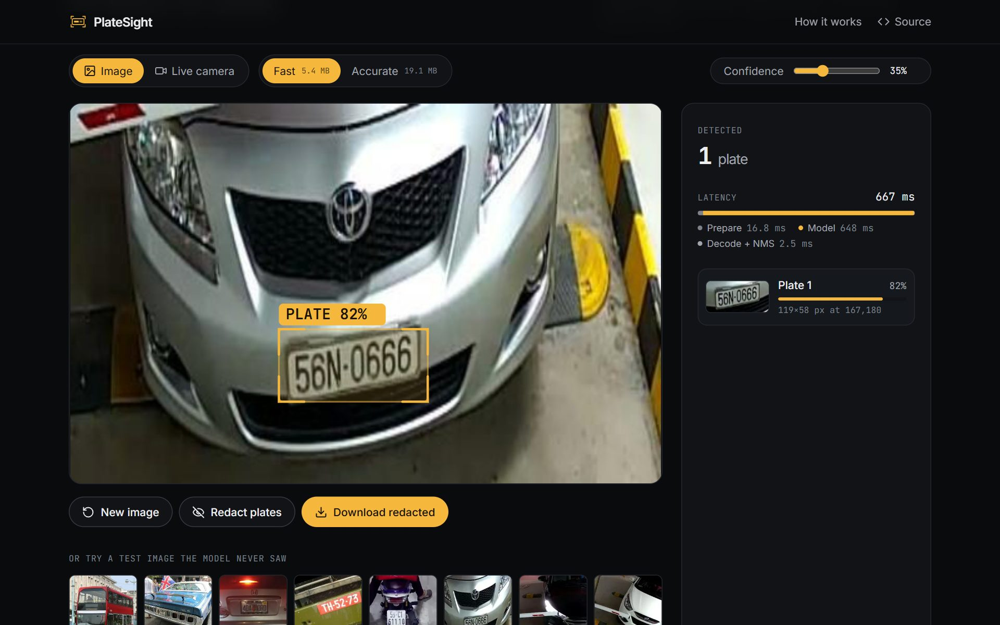

# PlateSight: License Plate Detection

A YOLO11 license plate detector that runs **entirely in your browser**. Detect plates in photos or live from your webcam, then redact them in one click. Images and frames never leave your device.

**[Live demo → platesight-xi.vercel.app](https://platesight-xi.vercel.app)**



> This is a rebuild of the license plate detection model from my Research Methods group project at Academic City University (Feb–May 2026), which I led. The training pipeline, models and web app in this repository were built from scratch in October 2026.

## Features

- **On-device inference:** ONNX Runtime Web in Web Workers. It answers on the CPU (multi-threaded WebAssembly) within about two seconds, and on devices with a hardware GPU it warms up WebGPU in the background and switches over when ready. Nothing is uploaded.
- **Two models:** *Fast* (YOLO11n, 640px) for live video and *Accurate* (YOLO11s, 768px) for photos, with each one's measured test accuracy shown in the app.
- **Image and live camera modes:** drag and drop, paste, browse, eight test-set samples, or real-time webcam detection with an FPS meter.
- **One-click redaction:** plates are pixelated (not blurred, so they can't be sharpened back) and the image downloads locally.
- **Hardened delivery:** strict Content-Security-Policy, self-hosted fonts, immutable caching for hashed assets, and the first model preloaded from the HTML.

## Results

Both models were trained on a Colab GPU for up to 120 epochs at 768px with early stopping (Fast peaked at epoch 76, Accurate at 64). Scores below are for the **exact ONNX files the app serves**, evaluated at the input size the app uses.

| Model | Input | mAP@50 in the wild | mAP@50–95 in the wild | Precision / Recall (wild) | mAP@50, Ghanaian plates | mAP@50, full test set | Download |
| :-- | :-- | :-- | :-- | :-- | :-- | :-- | :-- |
| **Fast** · YOLO11n | 640px | **0.873** | 0.583 | 0.945 / 0.821 | **0.956** | 0.907 | **5.4 MB** |
| **Accurate** · YOLO11s | 768px | **0.894** | 0.588 | 0.930 / 0.838 | **0.954** | 0.922 | **19.1 MB** |

- **In the wild:** 2,065 held-out Open Images photos (2,843 plates) of streets, cars and phone shots. This is the honest number.
- **Full test set:** those photos plus 882 held-out Roboflow images. The Roboflow split is mostly parking-garage CCTV with near-duplicate frames, which flatters scores, so it isn't reported alone.
- **Ghanaian plates:** all 321 photos (380 plates) of [Ghanaian License Plates](https://universe.roboflow.com/luther-eyandi/ghanaian-license-plates) (public domain), a dataset the models never saw: phone shots of cars in Accra car parks plus a few plate graphics. Neither model was trained on a single Ghanaian plate. Precision / recall: Fast 0.948 / 0.904, Accurate 0.918 / 0.918. Looking through the errors, many "false positives" are real plates on background cars that the dataset didn't label, so precision is understated; the genuine misses are mostly motion-blurred close-ups. The photos were stretched to 640×640 by the dataset's export, which a real camera wouldn't do. Scores come from `training/results/ghana.json`.
- On the eight varied sample images in the app, both models find all 8 real plates with no false positives (74–88% confidence). The dataset also labels a "CityBus" sign as a plate, which both models correctly ignore.

### Optimisation decisions

Every compression option goes through the same gate: it ships only if mAP@50 drops by at most 1 point on **both** test sets.

| Option | Fast | Accurate | Outcome |
| :-- | :-- | :-- | :-- |
| Input size 768 → 640px | −1.0 point in the wild, 1.5× faster | kept at 768 | Fast's job is live video, so speed wins there |
| INT8 static quantisation | −10.0 points in the wild | −1.9 points | **Rejected** by the gate; Accurate INT8 would score below Fast |
| Float16 weight storage | 10.7 → 5.4 MB, ±0.000 | 38.0 → 19.1 MB, ±0.0001 | **Adopted:** weights are stored in half precision and computed in float32 |

### Speed

Median per image on the eight samples, in Edge on an Intel i7-1255U laptop with Iris Xe graphics, **running on battery** (Balanced power plan). Both backends find the same plates.

| Model | WebAssembly (CPU, 4 threads) | WebGPU (Iris Xe) | Speed-up |
| :-- | :-- | :-- | :-- |
| Fast | 382 ms | **179 ms** | 2.1× |
| Accurate | 1,432 ms | **269 ms** | 5.3× |

WebGPU's first run compiles GPU shaders: about 8 s on a first visit, about 0.3 s afterwards because the browser caches them. So the app never waits for it: it is ready on the CPU as soon as the model has arrived, warms WebGPU in a second worker, and hands over once that worker is ready for the selected model. The WebGPU runtime is only fetched after the CPU worker is ready, so it never slows the first detection. On a repeat visit (files cached) the live site is ready in about 2 s and on WebGPU by about 6 s; a first visit depends on how fast the 5.4 MB model downloads. Devices without a hardware GPU never download the WebGPU runtime. Append `?backend=wasm` or `?backend=webgpu` to the URL to force one backend.

On mains power the CPU path is roughly 2.5–3× faster than these battery figures.

### Limitations

- Training data is mostly Vietnamese CCTV and Open Images photos. It transfers well to Ghanaian plates (0.95 mAP@50), but that test set is 321 car-park photos from one dataset; night scenes, moving traffic and motorbike plates are untested.
- Detection only: plates are located, not read (no OCR).
- On GPU devices the first visit downloads both runtimes (about 3.5 MB + 6.4 MB compressed); both are cached after that.

## How it works

1. **Data:** [Vehicle Registration Plates](https://universe.roboflow.com/augmented-startups/vehicle-registration-plates-trudk) (Augmented Startups, CC BY 4.0), plus up to 6,000 Open Images V7 *Vehicle registration plate* training photos for variety.
2. **Training:** a COCO-pretrained YOLO11 convolutional neural network fine-tuned as a single-class detector.
3. **Size and precision:** `benchmark_sizes.py` measures accuracy against speed per input size; `optimize_model.py` tries INT8, then float16 weights, behind the accuracy gate.
4. **Inference:** letterbox to the model's input size on an OffscreenCanvas, run the model, decode boxes and apply non-maximum suppression in TypeScript, then map back to the original pixels.

## Train it

**On a GPU (recommended):** open the notebook in Colab, pick a GPU runtime and *Run all*. It downloads `plates-model.zip`; unzip it into the repo root.

[](https://colab.research.google.com/github/Abiks06/license-plate-detection/blob/main/training/train_colab.ipynb)

Then, locally, choose the input size and optimise:

```bash
training/.venv/Scripts/python training/scripts/prepare_dataset.py --open-images 1 --open-images-splits test
training/.venv/Scripts/python training/scripts/benchmark_sizes.py --variant fast --sizes 512 640 768
training/.venv/Scripts/python training/scripts/export.py --variant fast --weights training/results/fast/best.pt --imgsz 640
training/.venv/Scripts/python training/scripts/optimize_model.py --variant fast
training/.venv/Scripts/python training/scripts/optimize_model.py --variant accurate
```

**Quick CPU-only run:**

```bash
python -m venv training/.venv
training/.venv/Scripts/python -m pip install torch torchvision --index-url https://download.pytorch.org/whl/cpu
training/.venv/Scripts/python -m pip install -r training/requirements.txt
training/.venv/Scripts/python training/scripts/prepare_dataset.py
training/.venv/Scripts/python training/scripts/train.py --variant fast --device cpu --imgsz 320 --epochs 3 --fraction 0.15
training/.venv/Scripts/python training/scripts/export.py --variant fast
```

**Run the app:** see [`web/README.md`](web/README.md).

### Test on Ghanaian plates

`evaluate_external.py` scores the served ONNX files on any dataset they never trained on. Download the Roboflow Universe datasets [Ghanaian License Plates](https://universe.roboflow.com/ghana-licenses/ghanaian-license-plates-6vwgc) (public domain) and [Ghana License Plate Detector](https://universe.roboflow.com/aklikaisaac300-gmail-com/ghana-license-plate-detector) (CC BY 4.0) in *YOLOv11* format, then:

```bash
training/.venv/Scripts/python training/scripts/evaluate_external.py --name ghana path/to/first.zip path/to/second.zip
```

It merges every split into one test set, keeps only plate classes, removes photos shared between the datasets and Roboflow's augmented copies, and writes `training/results/ghana.json` (plus an unaugmented "clean" subset score when an export was augmented). It also adds the scores and dataset credit to `models.json`, which the app shows. Pass several zips to merge datasets; the results above use the first dataset only.

## Repository layout

```
training/
  scripts/prepare_dataset.py   download + convert datasets to YOLO format
  scripts/train.py             fine-tune YOLO11 (fast / accurate)
  scripts/benchmark_sizes.py   accuracy vs speed per input size
  scripts/export.py            evaluate on test splits, export ONNX + models.json
  scripts/optimize_model.py    INT8 / float16 candidates behind an accuracy gate
  scripts/evaluate_external.py score the served models on an outside dataset (e.g. Ghana)
  results/{fast,accurate}/     trained weights, training curves, PR curves, confusion matrices
  train_colab.ipynb            one-click GPU training
web/                           PlateSight (Vite, React, Tailwind, Motion, ONNX Runtime Web)
docs/                          README assets
```

## Licenses

Code and models: [AGPL-3.0](LICENSE), as required by Ultralytics YOLO. Training data: CC BY 4.0; credit to Augmented Startups / Roboflow Universe and the Open Images authors. Sample images in the app come from the dataset's test split.
